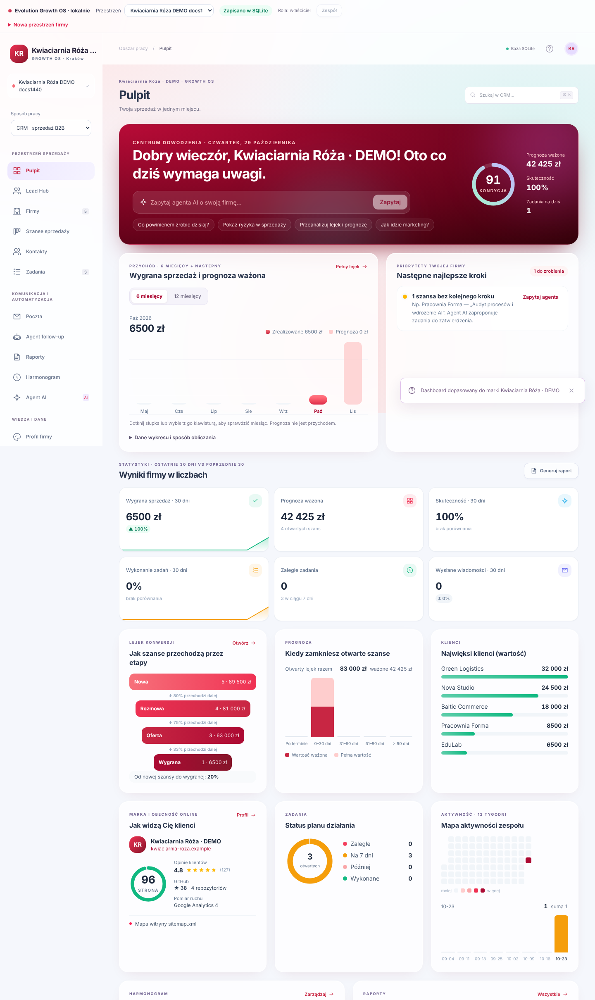
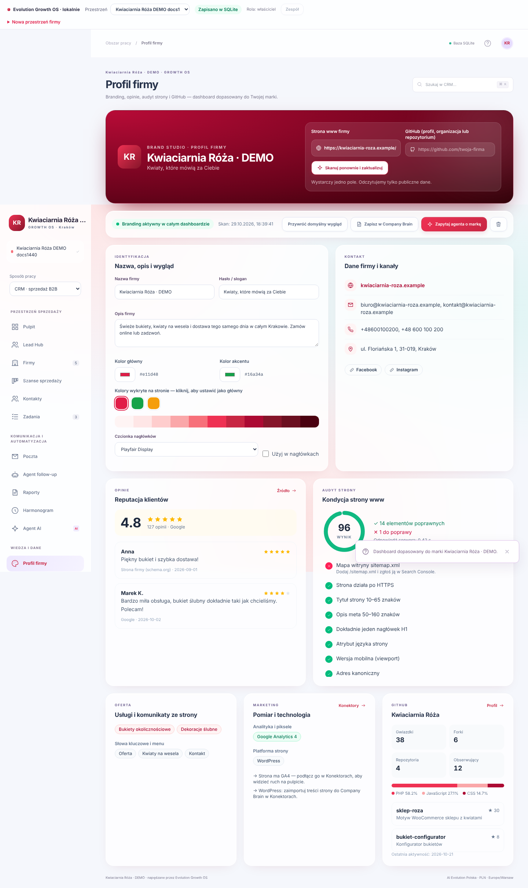
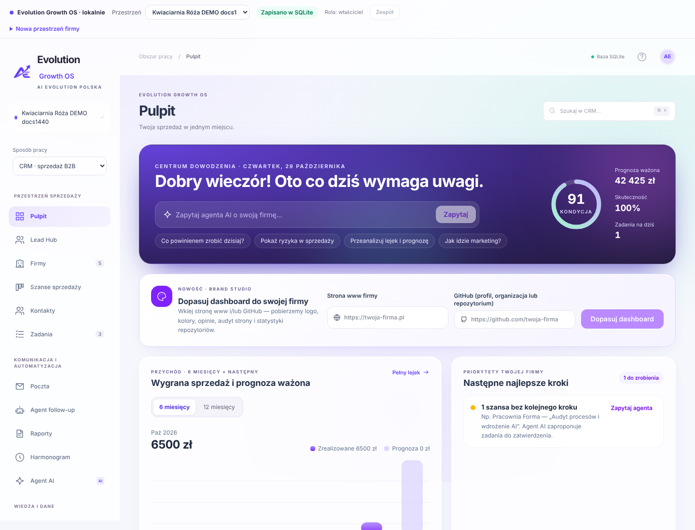

# Brand Studio i pulpit · 0.10

## Profil firmy z GitHub i strony www

**Profil firmy** (menu **Wiedza i dane**) oraz karta **Dopasuj dashboard do swojej firmy** na Pulpicie przyjmują adres strony www, link GitHub albo oba. Jedno kliknięcie:

1. Odczytuje publiczny HTML strony (do 3 przekierowań, każde ponownie sprawdzane), do 2 arkuszy CSS z tej samej domeny, `/sitemap.xml` i `/robots.txt`.
2. Wyciąga nazwę, slogan, opis, logo (schema.org → `` z „logo” → apple-touch-icon), ikonę, obraz Open Graph, kolory (theme-color, zmienne `--primary/--brand/--accent`, najczęstsze nasycone kolory), czcionki (Google Fonts i `font-family`), e-maile, telefony, adres, NIP, social media, ofertę (nagłówki H2/H3 i schema.org Service/Product), słowa kluczowe z menu, platformę strony i wykrytą analitykę (GA4, GTM, Google Ads, Meta Pixel, Hotjar, Clarity, PostHog…).
3. Odczytuje GitHub przez oficjalne REST API: profil lub organizację, repozytoria (bez forków i archiwów), gwiazdki, forki, języki, tematy i ostatnią aktywność. Link do repozytorium pokazuje to repozytorium i jego udział języków. Gdy nie podano strony, używany jest adres `homepage`/`blog` z GitHub.
4. Opinie: ocena i recenzje z danych `AggregateRating`/`Review` na stronie, a z kluczem `GOOGLE_PLACES_API_KEY` — ocena, liczba opinii i do 5 recenzji z Map Google (Places API New, wyszukiwanie po nazwie i mieście).
5. Audyt strony: 17 kontroli SEO i konwersji (HTTPS, tytuł, opis, H1, język, viewport, canonical, Open Graph, schema.org, alt, indeksowanie, kontakt, analityka, rozmiar HTML, sitemap, robots, czas odpowiedzi) z wagami i wynikiem 0–100.

Wynik od razu zmienia wygląd całej przestrzeni: logo i nazwa w menu, inicjały w nagłówku, kolor przycisków, wykresów, aktywnej nawigacji i gradient Centrum dowodzenia. Paleta 50–950 jest liczona w OKLCH z koloru głównego. Kolor zbyt jasny dla białego tekstu jest automatycznie przyciemniany do kontrastu WCAG ≥ 4,5:1. Czcionkę marki można włączyć dla nagłówków (Google Fonts).

W Profilu firmy poprawisz nazwę, slogan i opis, wybierzesz kolor główny i akcentu (także z kolorów wykrytych na stronie) oraz przełączysz **Przywróć domyślny wygląd / Zastosuj branding**. **Zapisz w Company Brain** (SQLite) tworzy lub aktualizuje notatkę „Profil marki — …” w kategorii Firma i marka. Agent AI dostaje profil jako `ownCompany` w kontekście (oferta, ocena, problemy strony, analityka) i używa go w rekomendacjach.

## Zapis i bezpieczeństwo

- Profil jest częścią ustawień przestrzeni: localStorage (tryb przeglądarki), SQLite lub Supabase (migracja `202610290001_brand_profile.sql`, limit 200 KB). Walidacja odrzuca adresy inne niż http/https, niepoprawne kolory i zbyt duże dane.
- `POST /api/brand/scan` działa tylko na localhost albo dla zalogowanych użytkowników Supabase i odrzuca żądania cross-site.
- Odczyt strony używa tej samej ochrony co generator Company Brain: tylko publiczne domeny HTTPS, DNS przypięty do połączenia TLS, blokada adresów prywatnych, limity rozmiaru i czasu. Przy wykrytym proxy HTTPS odczyt strony jest świadomie wstrzymywany; GitHub i Google Places działają przez proxy.
- Logo i obrazy są wyświetlane z adresu źródłowego z `referrerPolicy="no-referrer"`; błąd ładowania pokazuje inicjały.

## Pulpit

- **Lejek konwersji:** ile szans dotarło do każdego etapu i jaki procent przechodzi dalej (przegrane liczone na etapie „Nowa”).
- **Kiedy zamkniesz otwarte szanse:** wartość pełna i ważona prawdopodobieństwem w przedziałach po terminie / 0–30 / 31–60 / 61–90 / > 90 dni.
- **Jak widzą Cię klienci:** wynik audytu strony, ocena, GitHub, analityka i najważniejsze braki.
- Puste wykresy pokazują wskazówkę zamiast zer, a nagłówek Centrum dowodzenia nie twierdzi, że „wszystko idzie zgodnie z planem” w pustym CRM.
- Pasek przestrzeni u góry ma statusy zapisu w kolorach (zapisano / oczekuje / błąd).

## Ograniczenia

- Strony renderowane wyłącznie JavaScriptem mogą nie ujawnić kolorów i treści; ustaw je ręcznie.
- Opinie Google wymagają własnego klucza Places API (płatne powyżej darmowego limitu Google). Bez klucza pokazujemy tylko dane schema.org ze strony.
- GitHub bez tokenu ma limit 60 zapytań na godzinę z jednego adresu IP; skan zużywa 2–4 zapytania.

## Weryfikacja

`npm test` (77 testów, w tym parser strony, GitHub, paleta, walidacja, notatka Company Brain, kontekst agenta, lejek, harmonogram i przekierowania), `npm run lint`, `tsc --noEmit`, build SQLite oraz 20 scenariuszy Playwright SQLite (w tym Brand Studio z mockiem skanu: motyw, zapis w bazie, Company Brain, przywrócenie wyglądu, 390 px). Odczyt GitHub sprawdzono na żywym API; parser HTML — na zapisanym HTML prawdziwej polskiej strony firmowej.

